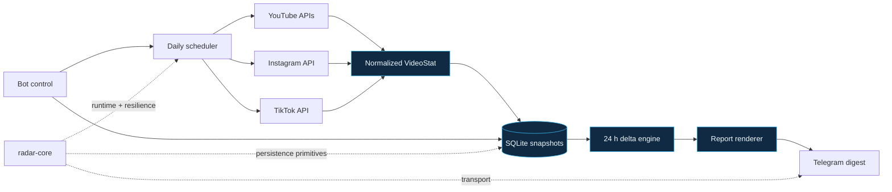

# Audímetro

[](https://github.com/Arreketefo/audimetro/actions/workflows/ci.yml)
[](https://www.python.org/)
[](LICENSE)

**A multi-platform audience analytics pipeline that turns daily snapshots into
one useful report.**

Audímetro collects video and short-form metrics from YouTube, Instagram and
TikTok, stores a daily history in SQLite, calculates 24-hour movement and sends
a concise Telegram digest. Each platform is isolated: a failed or expired
integration does not erase the healthy data from the others.

## What it does

- Captures public views and engagement for videos, shorts and reels.
- Adds watch time, average view duration and attributed subscribers when
  YouTube Analytics OAuth is configured.
- Detects new pieces and ranks the strongest 24-hour movers.
- Preserves daily snapshots for historical comparisons.
- Refreshes supported platform tokens and persists the latest valid state.
- Splits long Telegram reports without breaking individual metric rows.
- Offers `/stats`, `/hora` and `/informe` operational commands.
- Continues with partial results when one platform is unavailable.

## Architecture



Provider-specific OAuth and response parsing stay in this repository. Generic
runtime, persistence, resilience and Telegram transport come from
[`radar-core`](https://github.com/Arreketefo/radar-core).

## Example digest

Synthetic example — no real channel or account data:

```text
📊 Audímetro · lun 3 ago

▶️ YouTube · 184 200 views ▲ +3 420
     18 vídeos · 42 600 min vistos ▲ +910 · +37 subs
📸 Instagram · 91 040 views ▲ +1 870
     26 reels
🎵 TikTok · ⚠️ sin datos hoy
     token refresh temporarily unavailable

🆕 Nuevos
1. YT «Why smaller products cost more»
     short · 8 420 views · 👍 610 · 💬 28

🔥 Suben (24 h)
1. «The subscription trap»
     vídeo · 34 900 views ▲ +2 140 · 👍 +86 · +21 subs
```

## Stack

Python 3.12 · asyncio · httpx · APScheduler · SQLite/aiosqlite ·
pydantic-settings · Docker Compose · pytest · Ruff · mypy

## Quick start

Requirements: Python 3.12+, [`uv`](https://docs.astral.sh/uv/) and Git.

Clone `radar-core` and Audímetro side by side:

```bash
git clone https://github.com/Arreketefo/radar-core.git
git clone https://github.com/Arreketefo/audimetro.git
cd audimetro

cp .env.example .env
make install
make test
```

Without platform credentials the service starts in a safe degraded mode and
reports which sources are disabled. Tests use mocked HTTP transports and never
consume API quotas.

Run a forced local capture after configuring at least one source:

```bash
make tick
```

Run the scheduler in the foreground:

```bash
make dev
```

## Platform setup

### YouTube

Set `AUDIMETRO_YOUTUBE_API_KEY` and `AUDIMETRO_YOUTUBE_HANDLE` for public video
statistics. Optional Analytics metrics require an OAuth desktop client and a
refresh token created with:

```bash
uv run audimetro auth youtube
```

### Instagram

Use a professional account connected to a Meta developer application, then run:

```bash
uv run audimetro auth instagram
```

### TikTok

Configure a developer application with Login Kit and `video.list`, then run:

```bash
uv run audimetro auth tiktok
```

Exact environment names and safe defaults are documented in
[`.env.example`](.env.example).

## Operational commands

```text
/stats [yt|ig|tt] [n]  latest pieces ordered by views
/hora <0-23>           set the daily report hour in UTC
/informe               force a capture and replace today's scheduled report
/status                active sources, last report and token health
/config /set /reset    validated runtime configuration overrides
/pausa /reanuda        pause or resume scheduled captures
```

Bot access is restricted to configured chat IDs. Commands cannot execute a
shell or mutate arbitrary files.

## Quality

```bash
make test     # 53 focused tests
make lint     # Ruff + strict mypy
make package  # wheel + source distribution
make check    # all local quality gates
```

## Data and security

The SQLite database contains historical audience data and can also contain
refreshed platform tokens. Treat the database and its backups as secrets:

- never commit or upload database files;
- restrict volume and backup permissions;
- never paste tokens or account identifiers into issues;
- rotate credentials after accidental disclosure;
- use synthetic metrics in screenshots and fixtures.

See [`SECURITY.md`](SECURITY.md) for responsible reporting.

## License

Licensed under the [Apache License 2.0](LICENSE).
